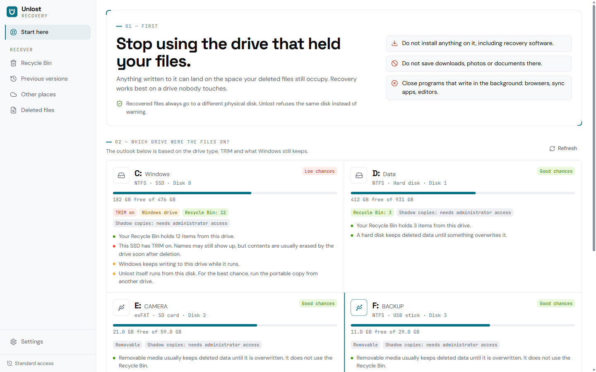
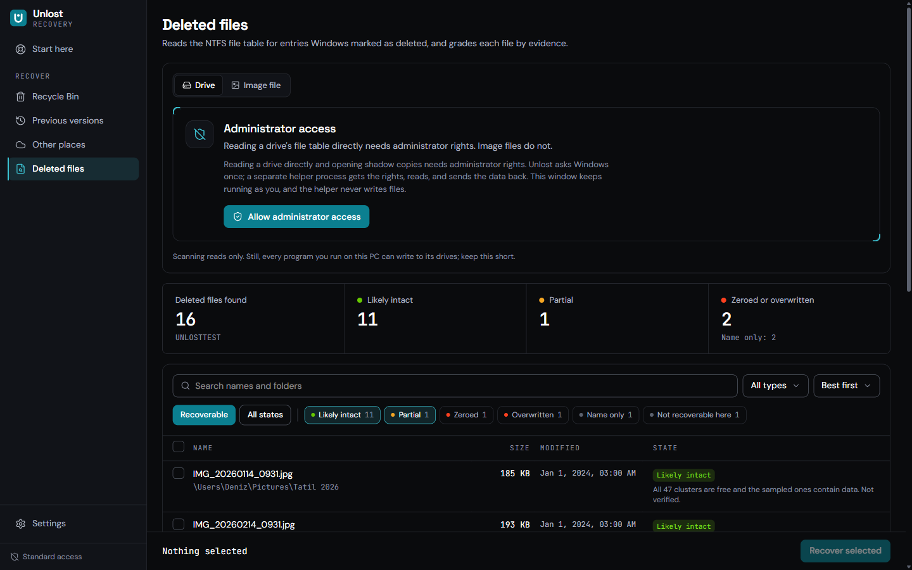
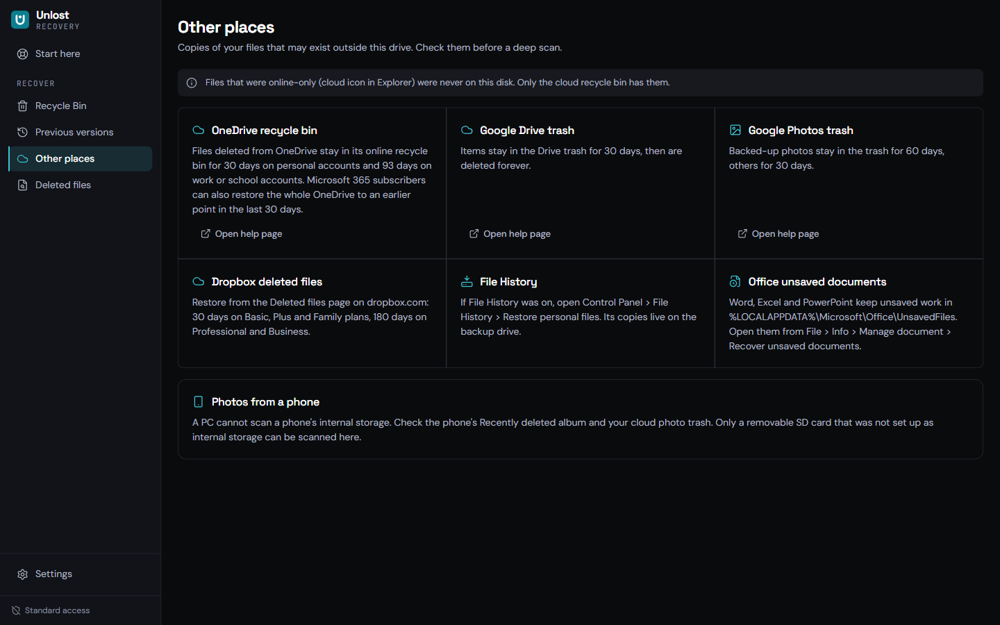

# Unlost

Windows 10 ve 11 için açık kaynak silinmiş dosya kurtarma aracı. Sürücülerinizi hiç yazmadan okur, herhangi bir taramadan önce Windows'un zaten sakladığı sağlam kopyaları sunar ve her dosya için gerçekte neyin kontrol edildiğini söyler. Hiçbir şeye "%100" denmez.

[English](README.md) · [Nasıl çalışır](docs/architecture.md) · [SSS](docs/faq.tr.md) · [Arkasındaki araştırma](docs/research.md)



Unlost, [ReClaim Cleaner](https://github.com/yusufky63/reclaim-cleaner)'ın kardeş uygulamasıdır. Bilerek ayrı bir uygulamadır: temizleyici normal kullanıcı olarak dosya siler; Unlost ise ham diskleri yönetici olarak okur ve kurtardığı diske asla yazmamalıdır.

## Ne yapar

- **Önce yazmayı bırakın.** İlk ekran neyin yapılmaması gerektiğini söyler, ardından her sürücüyü değerlendirir: sabit disk, SSD (TRIM durumuyla), USB bellek ya da SD kart, Windows sürücüsü, BitLocker ile kilitli, ReFS ya da FAT. Değerlendirme tek bir cümle ve arkasındaki gerçeklerdir.
- **Taramadan önce sağlam kopyalar.** Sırasıyla: her sürücüdeki Geri Dönüşüm Kutunuz (`$I`/`$R` dosyalarından okunur, başka bir yere kopyalanır, asla yerinde geri yüklenmez), var olan gölge kopyalar ("Önceki sürümler", salt okunur gezinilir) ve bulut çöp kutuları, Dosya Geçmişi, Office otomatik kayıtları ve telefonlar için yol gösterme.
- **NTFS'te silinmiş dosyalar.** `$MFT` içinde Windows'un silindi olarak işaretlediği kayıtları okur, klasör yollarını yeniden kurar (silinmiş klasörler dahil; kopuk zincirler "Lost folder #n" altına gider) ve her dosyayı küme bit eşlemine ve örneklenen içeriğe göre derecelendirir.
- **Dürüst durumlar.** Sağlam kopya, Büyük olasılıkla sağlam, Kısmi, Sıfırlanmış (TRIM), Üzerine yazılmış, Yalnızca ad, Burada kurtarılamaz. Her birinin gerekçesi vardır, örneğin "120 kümenin 38 tanesi artık başka dosyalara ait." "Doğrulandı" yalnızca bir çözücünün baştan sona okuduğu dosyalar içindir; bu sürümde henüz çözücü olmadığı için hiç gösterilmez.
- **Kendini kanıtlayan kurtarma.** Dosyalar başka bir fiziksel diskte yeni bir `Unlost <tarih>` klasörüne gider, yazılırken SHA-256 ile özetlenir, diskten yeniden okunup tekrar özetlenir; CSV ve JSON raporu her dosya için yöntemi, durumu, gerekçeyi ve özeti listeler. Hasarlı dosyalar `PARTIAL_`, `ZEROED_` ya da `OVERWRITTEN_` adını alır. Var olan hiçbir şeyin üzerine yazılmaz ve kurtarılan dosyalar sizin yerinize asla açılmaz.
- **Disk imajları da.** Bir `.vhdx`, `.img`, `.dd` ya da `.raw` imajını (tüm disk ya da tek birim) yönetici izni olmadan tarayın.
- İngilizce ve Türkçe, açık ve koyu tema.

| Silinmiş dosyalar | Diğer yerler |
|---|---|
|  |  |

## Güvenlik kuralları

Bunlar yalnızca arayüzde değil, motorda uygulanır.

1. **Yapı gereği salt okunur.** Sürücüler, birimler ve gölge kopyalar `GENERIC_READ` ve iki paylaşım bayrağıyla açılır. G/Ç arayüzünün yazma yöntemi yoktur. Hiçbir şey kilitlenmez, ayrılmaz, onarılmaz ya da yeniden yazılmaz.
2. **Asla kaynak disk.** Kurtarılan dosyalar, raporlar ve uygulamanın kendi verileri kurtarma yaptığınız fiziksel diske asla gitmez. Sürücü harfleri değil disk numaraları karşılaştırılır; sanal diskler imaj dosyasını tutan diski de sayar. Aynı disk uyarıyla geçilmez, reddedilir.
3. **Yeni gölge kopya yok.** Oluşturmak kaynak birime yazmak demektir. Yalnızca var olanlar okunur.
4. **Önce sağlam kopyalar:** Geri Dönüşüm Kutusu, gölge kopyalar, bulut çöp kutuları, otomatik kayıtlar.
5. **Taramadan önce riskler:** TRIM açık SSD, Windows sürücüsü, BitLocker, yalnızca bulutta olan dosyalar, şifreleme, ReFS ve FAT baştan açıklanır.
6. **Her dosya için bir durum ve gerekçe.** Asla "%100" yok; oyulan (carving) dosyalara asla uydurma ad verilmez.
7. **Çıkarılabilir ya da arızalı ortamda önce imaj;** bozuk sektörler bir kez tek başına okunur, sonra doldurulur ve sayılır. (İmaj alma planlanıyor; yol haritasına bakın.)
8. **Sağlamlaştırılmış ayrıştırıcılar.** Ayrıştırıcı crate'i `unsafe` kullanımını yasaklar, her bellek ayırmayı sınırlar ve fuzz testinden geçer.
9. **Telemetri yok, ücretli duvar yok, ağ yok.** Yardım bağlantıları yalnızca tıkladığınızda tarayıcınızda açılır.
10. **Her kurtarma için özetli bir rapor;** var olan dosyaların üzerine asla yazılmaz.

## Yönetici erişimi nasıl çalışır

Gördüğünüz pencere sizin hesabınızla çalışır, asla yükseltilmez. Bir adım yönetici izni gerektirdiğinde (bir sürücüyü doğrudan okumak, gölge kopyaları listelemek) Unlost Windows'tan bir kez izin ister ve aynı programı ayrı bir yardımcı olarak başlatır. Yardımcı pencereyle yalnızca sizin hesabınızın açabildiği bir adlandırılmış kanal üzerinden konuşur, pencerenin gerçekten Unlost olduğunu kontrol eder ve veriyi geri gönderir. Hiç dosya yazmaz: dosyaları pencere, korumanın onayladığı klasöre yazar. İzni başka bir yönetici hesabı onaylarsa yardımcı hizmet vermeyi reddeder. Ayrıntılar [docs/architecture.md](docs/architecture.md#processes) içinde.

## (Henüz) yapamadıkları

- FAT, exFAT ve ReFS'te silinmiş dosya taraması, imza tabanlı oyma (meta verisi olmayan fotoğraf ve videolar), disk imajı alma, önizleme, NTFS ile sıkıştırılmış ve CompactOS dosyaları. [ROADMAP.md](ROADMAP.md) dosyasına bakın.
- USB ile bağlanan telefonlar sürücü olarak değil medya aygıtı olarak görünür: Windows depolama alanını değil dosyalarını gösterir, bu yüzden hiçbir bilgisayar aracı onları tarayamaz. Bir telefon takıldığında Unlost bunu söyler.
- SSD'de TRIM, tam biçimlendirme, `cipher /w` ya da güvenli silmeden sonra veri gitmiştir. Hiçbir yazılım geri getiremez.

## İndirme

Henüz sürüm yok. Sürümler NSIS kurulumu (kullanıcı başına), MSI paketleri (İngilizce ve Türkçe) ve taşınabilir zip olarak, SHA-256 sağlamalarıyla yayınlanacak. Unlost'u çalıştırmanın önerilen yolu taşınabilir sürümdür: bir USB bellekten başlatıldığında kendi dosyaları kurtarma yaptığınız diskten uzak durur.

## Kaynaktan derleme

Gerekenler: Windows 10 ya da 11, [Rust](https://rustup.rs) (stable, MSVC), Node.js 22 ya da üstü, pnpm 9 ve Visual Studio C++ derleme araçları.

```bash
pnpm install
pnpm app:dev
```

Kurulum dosyaları ve taşınabilir zip:

```bash
pnpm app:build
```

```bash
pnpm portable
```

## Testler

```bash
pnpm check
```

```bash
cargo test --workspace
```

NTFS ayrıştırıcısı bellekte kurulan sentetik birimlerde, VHDX ve GPT katmanları üzerinden ve Windows'un oluşturduğu VHDX imajlarında test edilir. `scripts/make-fixtures.ps1` (yönetici olarak) bu imajları Windows'un kendi NTFS'iyle oluşturur, içlerinde dosya siler ve SHA-256 bildirimleri yazar; `crates/core/tests/vhdx_scenarios.rs` "büyük olasılıkla sağlam" denen her dosyanın bayt bayt kurtarıldığını kontrol eder. Yönetici gerektiren testler (ham birimler, gölge kopyalar, gerçek bir birimin tam taraması) `crates/core/tests/elevated.rs` içindedir. Ayrıştırıcıların `fuzz/` altında cargo-fuzz hedefleri vardır. Bkz. [docs/testing.md](docs/testing.md).

## Gizlilik

Unlost hiçbir ağ bağlantısı kurmaz ve hiçbir şey toplamaz. Yalnızca kendi Geri Dönüşüm Kutunuz listelenir. Kurtarma raporları seçtiğiniz kurtarma klasöründe kalır.

## Lisans

[MIT](LICENSE). GPL, LGPL ya da AGPL lisanslı kurtarma araçlarından hiçbir kod kullanılmaz; bkz. [docs/research.md](docs/research.md#24-licence-rules-for-an-mit-project).
